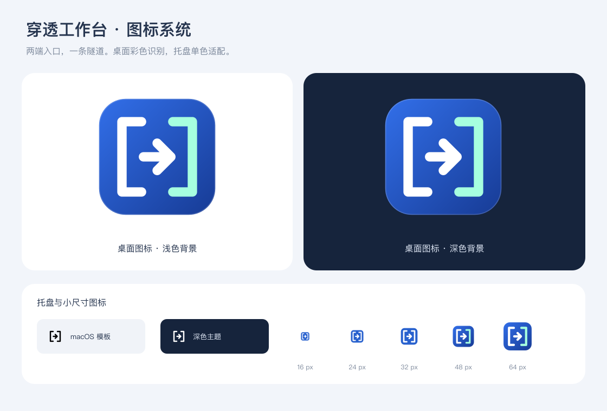

# 穿透工作台

基于 Electron、Vue 3、TypeScript 和 FRP 的桌面工具，用于管理 Linux 转发服务器与本机穿透实例。界面为中文，支持 macOS、Windows、Linux；当前已在 Intel Mac 和真实 Linux x64 服务器验证，其他桌面系统的实机验收见 [验证记录](VERIFICATION.md)。

## 品牌图标

标志以两端入口和中间隧道为图形概念，桌面采用蓝色渐变彩色图标，托盘使用适配浅色与深色菜单栏的单色图形。跨平台源文件位于 `assets/brand/`，生成资源位于 `assets/icons/`。



## 开始使用

需要 Node.js 22.12 及以上版本。

```sh
npm ci
npm run dev
```

界面代码热更新；修改主进程或 preload 后重新运行开发命令。

生产运行：

```sh
npm run build
npm start
```

生成当前系统安装包：

```sh
npm run dist
```

跨架构构建可执行 `npm run dist -- --mac --arm64 --publish never` 或 `npm run dist -- --linux --arm64 --publish never` 或 `npm run dist -- --win --x64 --publish never`；Windows 首批目标为 x64。每次打包的输出按版本与目标平台隔离，例如 `release/0.2.1/mac/`、`release/0.2.1/win/` 或 `release/0.2.1/linux/`；不指定平台时使用当前构建机平台。一次只打包一个平台。

仅生成应用目录：`npm run pack`。产物位于对应版本和平台子目录。Windows 为 NSIS/便携包，macOS 为 DMG/ZIP，Linux 为 AppImage/tar.gz。正式发行仍需配置相应的签名、公证凭据；开发包未签名。DEB 构建需要真实项目主页及维护邮箱，本次默认使用无需这些字段的 Linux 通用包；填写元数据后可执行 `npm run dist -- --linux deb`。

当前构建机生成的 Mac 应用位于 `release/{版本}/mac/` 下。

## 第一次分享

1. 在「服务器」添加 SSH 登录信息与 FRP 公网地址。二者可以不同；SSH 端口默认 22，FRP 端口默认 7000。密钥支持选择文件和直接输入路径。
2. 生成随机连接令牌。访客不需要令牌；令牌用于客户端连接 FRP 服务器。
3. 在「版本库」安装本机平台包和服务器对应的 Linux 包。先查询官方版本；API 限流时会自动切换官方发布页面，网络完全不可用时可使用缓存、手动官方地址或离线完整包。
4. 连接 SSH 并独立核对首次主机指纹。应用会自动读取发行版、内核、CPU、内存、磁盘和端口信息，再按实际服务管理器与权限部署；安装后明确点击「启动」。
5. 创建客户端实例，选择服务器及本机版本。一个实例可添加多个规则，多实例可同时运行。
6. 启动后查看 FRP 登录与各规则的注册状态，再复制访问地址。

HTTP/HTTPS 规则支持多个域名，每行填写一个，也可用逗号分隔。访问卡片会为每个域名单独显示可复制地址。HTTPS 规则可选择透传到本地 HTTPS 服务，或由运行 `frpc` 的设备终止 TLS 并转发到本地 HTTP 服务。

「SSL 证书」页管理运行 `frpc` 设备上的证书：可导入 PEM 证书与私钥，或通过 Let’s Encrypt、LiteSSL 签发一张覆盖多个域名的 SAN 证书，再关联到一个或多个 HTTPS 终止规则。DNS-01 需要按提示手动添加 TXT 记录；HTTP-01 要求 FRP HTTP 入口为公网 80，并会在确认后临时重启相关实例、验证完成后恢复。证书文件在本机应用数据目录中按受限权限保存，私钥不会写入 FRP 配置文本。自动续期需系统安全存储可用，并且只在应用运行或驻留托盘时检查；DNS-01 续期时仍需手动更新 TXT。证书更新后需重启相关实例加载新证书。

发起 ACME 签发后会显示实时进度窗口，记录账户准备、域名验证、CA 重试、证书校验和保存等阶段；DNS-01 可直接在窗口查看 TXT 记录并继续验证。签发过程中可取消，程序会中止网络请求并清理 HTTP-01 临时配置；若当前系统密钥操作尚未返回，取消会在该操作完成后生效。

无域名的网站使用 TCP 规则，例如本地 `127.0.0.1:3000` 映射到服务器 `18080`，访问 `http://服务器地址:18080`。HTTP/HTTPS 域名规则需将域名解析到服务器，并放行相应入口端口。客户端 HTTPS 可转发本地 HTTPS，也可使用本机证书终止后转发到本地 HTTP。

服务器防火墙及云安全组需要放行连接与实际代理端口，本工具不自动修改。代理已注册不代表 DNS、证书、公网入口或本地服务已验证可用。

## 版本库与下载兜底

- 主渠道为 GitHub Releases API，按发布资产匹配系统与架构，支持分页。不会抓取 Tags 网页或把源码包当成可运行安装包。
- API 限流或不可用时自动读取 GitHub 官方 Releases 页面；官方页面也不可用时读取本地版本列表缓存并展示缓存时间，已下载包可再次用于部署。
- 冷启动无缓存时可输入版本与官方安装包 URL，或导入完整 ZIP/tar.gz 包。仅导入单个二进制不受支持。
- 查询与下载分别提示错误；网络设置支持无内嵌凭据的 HTTP、HTTPS、SOCKS5 代理，仅作用于版本查询及下载。
- 有发布方 SHA256 时必须校验；官方 FRP 发布页会自动读取该版本的 `frp_sha256_checksums.txt`。已安装但未核对的官方版本也可手动核验；仍无官方摘要时明确确认来源。解压只保留 frpc/frps，拒绝重复程序、软链接和超大内容。
- 本机包执行实际版本检测；服务器包在上传后检测平台与实际版本。客户端和服务端版本不同会提示，不强制一致。
- 表单配置面向 v0.52.0 及以上的常用功能。旧版使用原始配置，未承诺全部旧版兼容。选择现代版本时执行该版本的 `verify`。

官方手动下载地址示例：

```text
https://github.com/fatedier/frp/releases/download/v0.71.0/frp_0.71.0_darwin_amd64.tar.gz
https://github.com/fatedier/frp/releases/download/v0.71.0/frp_0.71.0_linux_amd64.tar.gz
https://github.com/fatedier/frp/releases/download/v0.71.0/frp_0.71.0_windows_amd64.zip
```

示例版本是验证使用的版本，不表示永远为最新版本。

## 配置与远程维护

常用表单生成 TOML。客户端进入高级模式后，完整原始配置为唯一来源；不会反向解析未知字段。恢复表单需明确放弃原始内容。高级配置中的实际服务器地址和认证信息由配置自身决定。

服务器保存仅更新本机管理配置。「应用已保存配置」才会校验、备份并写入远程文件，服务保持原状；点击重启才生效。已有部署的配置格式应与配置文件扩展名一致，更换格式需要重新部署。

接管需要指定程序、配置、日志、PID 路径和服务名称，应用会自动识别 systemd、OpenRC、SysV 或匹配的后台进程。服务程序或配置无法匹配时拒绝操作。systemd 校验不依赖新版本的 `--value` 参数，以兼容 CentOS 7 等较旧系统；状态查询失败时会显示诊断原因。

版本替换必须先停止服务，保留程序与配置备份，不自动转换或启动。「查看 / 恢复备份」可分别恢复程序和配置，恢复前再备份当前文件，使用实际程序校验，恢复后需明确启动。

服务器页面只有一个「卸载」入口。有关联客户端时必须先删除实例或更换关联。确认框默认同时停止并卸载远端服务及记录的程序、配置、日志和 PID 文件，历史备份保留；也可选择只移除本机配置并解除管理，让远端服务继续运行。远端卸载会在需要时自动连接 SSH，失败时保留本机配置。

普通用户安装在自己的 `~/.local/share/intranet-frp/`。有权限时自动使用服务器实际运行的 systemd、OpenRC 或 SysV 服务管理器；systemd 环境优先使用系统服务，没有系统权限但用户 systemd 可用时使用用户服务。服务管理器或权限不可用时回退为后台进程。第一版不处理交互 sudo 密码。

## 凭据、日志和退出

应用状态保存在 Electron `userData` 目录，版本包按版本/平台/架构隔离。密码、令牌、密钥口令和原始配置使用系统安全存储加密；Linux 的 `basic_text` 后端不视为安全存储。不可用时仅在会话中保留敏感内容，重启后需要重新输入。SSH 私钥文件不复制进应用数据目录。

正在运行的 FRP 需要读取本机临时配置，使用当前用户权限创建，停止和正常退出后清理。远程配置同样限制权限。客户端日志限制长度并脱敏，可在日志窗口清除；服务器进程、OpenRC、SysV 和文件日志模式可清空单独的 FRP 日志文件。systemd journal 日志无法只清理单个服务的历史记录，应用会说明原因，不会清理其他服务的系统日志；日志文件缺失时自动回退读取 journal。

关闭窗口进入托盘。选择「退出并停止本机穿透」时停止本工具启动的客户端；远程服务继续运行。系统强杀或掉电不等同于正常退出，不承诺这类情况下的进程清理。

Windows 风险提示应先核对官方来源、校验值及安全产品检测结果，再按需处理单文件误报或申诉；不会关闭防护或添加白名单。macOS 正式发行需签名与公证，未签名开发包的钥匙串身份可能随构建变化。

## 开发与验证

```sh
npm run typecheck
npm test
npm run format:check
npm run test:desktop
```

真实服务器测试需要显式设置环境变量及已独立信任的 `known_hosts`。`scripts/remote-smoke.ts` 使用 7000/8080/8443 和 18080/18081，需先确认端口未占用；脚本在独立目录部署，结束后停止和卸载。不要对正在承载业务的服务器直接运行这些测试。

```sh
INTRANET_TEST_HOST=你的测试服务器 \
INTRANET_TEST_KEY=/绝对路径/私钥 \
INTRANET_SMOKE_DATA=/绝对路径/独立测试数据 \
npm run test:remote
```

`test:remote-user` 使用已有 Linux 包，创建并删除临时普通账号，分别测试用户服务和进程模式；`test:local-frp` 使用已有本机包，测试多实例、跨版本、端口冲突、认证失败和断线恢复。测试脚本及个人测试数据不打入应用包。

发行包不包含 SSH 库的可选原生加速模块，使用该库支持的 Node.js 加密和 JavaScript/WASM 回退，避免依赖目标系统编译工具或混入其他平台的原生文件。

核心结构：`src/shared` 为参数与接口，`src/main` 为存储/FRP 适配/版本/SSH/进程管理，`src/preload` 仅暴露固定 IPC 通道，`src/renderer` 为 Vue 界面。渲染进程不开启 Node 集成，主进程校验每个入口参数，禁止页面导航和新窗口。
