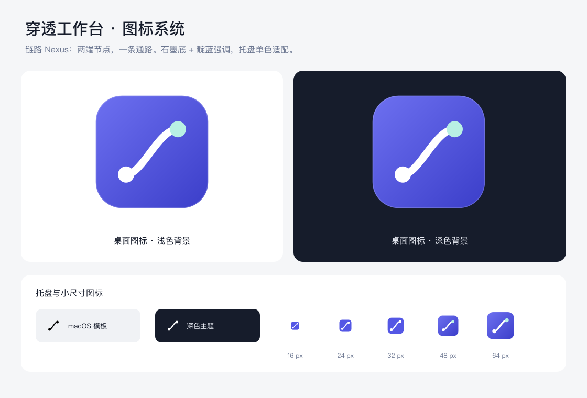

# 穿透工作台

基于 Electron、Vue 3、Ant Design Vue、TypeScript 和 FRP 的桌面工具，用于管理 Linux 转发服务器与本机穿透实例。界面为中文，支持 macOS、Windows、Linux；当前已在 Intel Mac 和真实 Linux x64 服务器验证，其他桌面系统的实机验收见 [验证记录](VERIFICATION.md)。

## 品牌图标

标志以两端入口和中间隧道为图形概念，桌面采用蓝色渐变彩色图标，托盘使用适配浅色与深色菜单栏的单色图形。跨平台源文件位于 `assets/brand/`，生成资源位于 `assets/icons/`。



## 开始使用

需要 Node.js 22.12 及以上版本。

```sh
npm ci
npm run dev
```

界面代码热更新；修改主进程或 preload 后重新运行开发命令。

生产运行：

```sh
npm run build
npm start
```

生成当前系统安装包：

```sh
npm run dist
```

跨架构构建可执行 `npm run dist -- --mac --arm64 --publish never` 或 `npm run dist -- --linux --arm64 --publish never` 或 `npm run dist -- --win --x64 --publish never`；Windows 首批目标为 x64。每次打包的输出按版本与目标平台隔离，例如 `release/0.2.1/mac/`、`release/0.2.1/win/` 或 `release/0.2.1/linux/`；不指定平台时使用当前构建机平台。一次只打包一个平台。

仅生成应用目录：`npm run pack`。产物位于对应版本和平台子目录。Windows 为 NSIS/便携包，macOS 为 DMG/ZIP，Linux 为 AppImage/tar.gz。正式发行仍需配置相应的签名、公证凭据；开发包未签名。DEB 构建需要真实项目主页及维护邮箱，本次默认使用无需这些字段的 Linux 通用包；填写元数据后可执行 `npm run dist -- --linux deb`。

当前构建机生成的 Mac 应用位于 `release/{版本}/mac/` 下。

## 第一次分享

1. 在「服务器」添加 SSH 登录信息与 FRP 公网地址。二者可以不同；SSH 端口默认 22，FRP 端口默认 7000。密钥支持选择文件和直接输入路径。
2. 生成随机连接令牌。访客不需要令牌；令牌用于客户端连接 FRP 服务器。
3. 版本无需预先准备：连接 SSH 后直接点「安装服务端」，工具按服务器架构自动选版并下载；创建客户端时按所选服务器版本与本机架构自动补齐。也可在「版本库」手动获取列表、指定版本或离线导入。
4. 连接 SSH 并独立核对首次主机指纹。应用会自动读取发行版、内核、CPU、内存、磁盘和端口信息，按实际服务管理器与权限部署，安装完成后自动启动服务。
5. 创建客户端实例，选择服务器（版本与架构自动带出，可更换）。规则在实例详情页的「站点 / 服务」标签中独立增删改：站点是 Web（HTTP/HTTPS）规则，服务是 TCP/UDP 规则；列表以表格显示规则名称、类型、本地地址和端口，点名称或「编辑」打开规则表单，「删除」移除。保存配置或规则时若实例正在运行会自动重启。多实例可同时运行。
6. 启动后查看 FRP 登录与各规则的注册状态，再复制访问地址。

HTTP/HTTPS 规则支持多个域名，每行填写一个，也可用逗号分隔。访问卡片会为每个域名单独显示可复制地址。TLS 终止位置只由服务端配置的 `vhostHTTPPort` 决定：标准 80 端口走方案 B（本机 frpc 终止）；非标端口走方案 A（服务器 Web 服务终止），且必须满足 Web 服务、include 注入、探针三项前置条件才能申请证书。

## 端口选择（重要）

`vhostHTTPPort` / `vhostHTTPSPort`（表单里的「HTTP 入口」「HTTPS 入口」）按服务器实际情况手填：

- **`vhostHTTPPort = 80`**：方案 B，证书保存在本机，由 frpc 的 `https2http` 终止 TLS。
- **`vhostHTTPPort ≠ 80`（如 8080）**：方案 A，证书写入服务器托管目录，由服务器 Web 服务终止 TLS；申请前必须检测到 Web 服务、存在 include 注入记录且探针生效，任一不满足即阻止申请，不自动降级为方案 B。
- 443 占用、权限、非 Nginx 等因素只提示，不改变方案。安装 nginx / Docker Web 服务前，请先卸载本工具释放端口；卸载按清单清理并生成残留报告。

## 证书管理与申请

「证书管理」页只展示已签发的证书及部署位置；申请、导入、移除证书统一在「客户端实例 → Web 规则 → SSL」中操作。规则默认保持 HTTP，不提供「启用 HTTPS」开关：签发或导入证书后会生成不显示在列表中的 HTTPS 伴随规则（方案 B），或把 HTTP 规则标记为公网 HTTPS 回源（方案 A）。移除证书会回退到 HTTP。签发与部署共用一个进度，任何一步失败都会撤销本次写入的证书文件、store 记录、规则引用与 DNS TXT，不留半成品。

- **Web 规则证书面板**：编辑态「基础 / 配置文件 / SSL」三个标签。SSL 标签可粘贴其它机构签发的 PEM 与 KEY，或点「申请证书」；方案 A 下配置文件标签异步读取服务器真实文件，编辑器显示加载遮罩，可「读取服务器」刷新或「保存配置」写回。
- **申请证书表单**：签发机构单选（Let’s Encrypt / LiteSSL），证书算法 RSA 2048 / 3072 / 4096，验证方式（文件验证 / DNS 验证），域名从当前 Web 规则勾选并支持全选。方案 A 前置条件不满足时显示阻止原因且提交按钮禁用。
- **DNS-01 自动验证**：用「设置 → DNS 账户」中已保存的账户（DNSPod / 阿里云 DNS / Cloudflare）自动增删 TXT；凭据探测失败直接报错。阿里云 TTL 用最小合法值 600 秒。
- **HTTP-01 文件验证**：目标服务器已由 Web 规则固定，无需选择实例；主进程优先使用规则所属实例，否则取该服务器唯一的表单模式实例。方案 A 由服务器 nginx 的临时 challenge server 应答，方案 B 通过 frpc 临时通道应答。
- **部署**：方案 A 写服务器托管目录并重载 Web 服务；方案 B 写本机 `certificates/<id>/`（目录 700、文件 600）并让 frpc 使用。签发与部署共用同一个进度，失败整体回滚。
- **暂不包含**：自动续期与部署级别。相关旧入口已从页面移除。

签发与部署进度显示在右下角进度浮层；下载统一走右下角常驻任务中心。

无域名的网站使用 TCP 规则，例如本地 `127.0.0.1:3000` 映射到服务器 `18080`，访问 `http://服务器地址:18080`。HTTP/HTTPS 域名规则需将域名解析到服务器，并放行相应入口端口。

服务器防火墙及云安全组需要放行连接与实际代理端口，本工具不自动修改。代理已注册不代表 DNS、证书、公网入口或本地服务已验证可用。

左侧「终端」可为已添加服务器打开多个 SSH PTY 标签。关闭标签会结束该 SSH shell；「常用」命令保存在本机并由所有服务器共用，支持编辑、删除、排序和执行。「记录」按当前标签对应的登录用户读取 bash、zsh、fish 或 sh 的 history 文件；新命令是否立即出现取决于 shell 的 history 写入设置，部分 shell 会在退出时才保存。历史命令和收藏命令都只有在用户双击或从菜单执行时才会发送到当前终端。

## 版本管理与下载任务中心

**版本选择下沉到使用点**，不再要求先去版本库手动装包：

- **安装服务端**：连接 SSH 后自动探测服务器架构（`uname -m` → amd64 / arm64），默认取本地列表最新稳定版；点「安装服务端」先做安装前预检：① FRP / HTTP / HTTPS 端口被占用则终止并提示更换；② 检索到已有 FRP 服务，三选「保存为只读连接」（读取服务端 frps 配置并把端口 / 令牌回填到本地服务器配置，仅用于创建客户端）或「移除并重新安装」（停服务、禁开机、备份程序与配置后删旧单元）或「取消」；③ 安装目录已有程序则询问是否覆盖上传。若本机没有对应 Linux 安装包，先自动下载并在右下角任务中心显示进度。确认后右下角即刻出现安装进度面板（下载任务中心自动上移让位），逐阶段显示探测 / 上传（真实传输字节）/ 配置 / 服务安装 / 自动启动，失败给出具体原因与下一步建议。
- **创建客户端**：版本号跟随所选服务器已部署的 FRP 版本，架构取本机平台；服务器尚未部署时取列表最新稳定版并提示「部署后建议改为一致」。保存实例时缺包自动下载；下载失败或被取消则不保存，避免留下指向不存在程序的配置。
- **切换服务端版本**：选择目标版本号，缺包同样自动下载后再切换。两个使用点都提供「更换版本」下拉；架构不支持（非 amd64 / arm64）时明确提示手动选择或离线导入，不会静默猜测。

**版本列表缓存**：列表随 `state.json` 本地持久化，**启动直接回显、绝不自动联网**；联网只发生在手动点击「获取 / 刷新列表」时。页面明确显示本次是「在线获取 · GitHub Releases API / 官方发布页」还是「本地缓存回显」，以及列表更新时间；超过设置的缓存时长只提示、不自动刷新。

**下载任务中心**：点击即刻在右下角出现任务，不再有静默等待；跨页面常驻、可收起为小胶囊、可展开查看多个任务，显示阶段、百分比、速度、已接收/总量与步骤时间线，支持暂停 / 重试 / 关闭。下载不再锁死整个界面。底层仍是 HTTP Range 断点续传（稳定 `.part` + ETag / Last-Modified），失败保留分片，校验失败才清理。

- 列表主渠道为 GitHub Releases API；限流或不可用时自动读取 GitHub 官方 Releases 页面；两条都失败时回退本地记录并标记为离线缓存。
- 冷启动无缓存时可输入版本与官方安装包 URL，或导入完整 ZIP/tar.gz 包。仅导入单个二进制不受支持。
- 查询与下载分别提示错误；网络设置支持无内嵌凭据的 HTTP、HTTPS、SOCKS5 代理。
- 有发布方 SHA256 时必须校验；官方 FRP 发布页会自动读取该版本的 `frp_sha256_checksums.txt`。已安装但未核对的官方版本也可手动核验；仍无官方摘要时明确确认来源。解压只保留 frpc/frps，拒绝重复程序、软链接和超大内容。
- 本机包执行实际版本检测；服务器包在上传后检测平台与实际版本。客户端和服务端版本不同会提示，不强制一致。
- 表单配置面向 v0.52.0 及以上的常用功能。旧版使用原始配置，未承诺全部旧版兼容。选择现代版本时执行该版本的 `verify`。

官方手动下载地址示例：

```text
https://github.com/fatedier/frp/releases/download/v0.71.0/frp_0.71.0_darwin_amd64.tar.gz
https://github.com/fatedier/frp/releases/download/v0.71.0/frp_0.71.0_linux_amd64.tar.gz
https://github.com/fatedier/frp/releases/download/v0.71.0/frp_0.71.0_windows_amd64.zip
```

示例版本是验证使用的版本，不表示永远为最新版本。

## 界面与交互

侧栏按工作流分组：基础设施（服务器、版本库）、穿透（客户端实例）、证书（证书管理）、工具（终端、设置、帮助）。帮助为独立页面，TLS 入口菜单已移除。

反馈按场景分级：轻量结果用非阻塞 Toast；删除 / 卸载 / 覆盖配置用应用内确认框（危险操作需输入确认词，默认「取消」）；长任务按类型分流——下载走右下角常驻任务中心，证书签发走浮层进度面板；表单用统一弹窗；字段校验用内联错误。确认统一在渲染层完成后才向主进程下发 `confirmed`，避免系统原生弹窗与页面确认重复。本工具为桌面应用，布局覆盖桌面与窄窗口两档：窗口变窄时侧栏收为图标条、表单改单列、列表改卡片堆叠，不提供手机端适配。

## 托管 TLS 实例（能力保留，界面入口已移除）

工具仍自带单文件静态 TLS 反代（Go 标准库编译，`assets/bin/tls-proxy-linux-*`）及清单驱动安装/卸载能力，但当前界面不再提供 TLS 入口菜单，相关操作仅保留在 IPC 层供后续需要时恢复。

所有资源只在 `~/.local/share/intranet-frp/tls-proxy/`（独立二进制、配置、日志、pid、证书目录、独立 unit 名 `intranet-frp-tls`），**绝不触碰** `/etc/nginx`、`nginx.service`、包管理器数据库、系统日志目录、系统用户/组、PATH、sudoers 与持久防火墙规则。安装时把每个创建的资源登记进清单；提供「让位（仅停止并释放 80/443，保留文件）」与「一键卸载（按清单逆序完全清除）」，卸载前后做资源快照对比，被用户改动过的文件不删并列入报告。检测到系统 nginx 出现时主动提示让位，避免端口冲突，不影响日后正常安装 nginx。

## 配置与远程维护

常用表单生成 TOML。客户端进入高级模式后，完整原始配置为唯一来源；不会反向解析未知字段。恢复表单需明确放弃原始内容。高级配置中的实际服务器地址和认证信息由配置自身决定。

服务器面板的「系统信息」集中展示内核、CPU、内存、磁盘、服务管理器，以及 80/443 端口占用和常见 Web 服务（nginx / Apache / Caddy 等）的安装与运行状态，点击标题可展开或收起。

右上角「编辑配置」保存时即校验、备份、写入远程配置并重启服务，不需要先断开 SSH；「读取远程配置」可直接载入编辑表单再保存。程序与配置文件路径在编辑表单的「部署路径（只读）」中展示。已有部署的配置格式应与配置文件扩展名一致，更换格式需要重新部署。

服务端部署区按服务状态显示按钮：停止时只有「启动」，运行时显示「停止 / 重启」；「查看日志」只打开日志窗口。开机启动用开关切换，后台进程模式不可用。点击版本徽标打开「切换服务端版本」弹窗；版本替换会停止当前服务并替换程序，之后需手动启动。

已有 FRP 服务可在连接 SSH 后使用「检索服务」扫描 systemd、OpenRC、SysV 服务和运行进程，也可输入服务名关键词筛选。应用核验 FRP 程序及配置路径，读取客户端连接所需端口和认证令牌，并保存为只读服务器记录；该记录可供多个客户端实例使用，界面隐藏且 IPC 禁止服务端启停、配置修改、站点管理和远端卸载。配置读取失败时提示权限原因，不自动提权；令牌优先使用系统安全存储，不可用时只在当前会话保留，重启后需重新检索。

版本替换必须先停止服务，保留程序与配置备份，不自动转换或启动。「查看 / 恢复备份」可分别恢复程序和配置，恢复前再备份当前文件，使用实际程序校验，恢复后需明确启动。

服务器页面只有一个「卸载」入口。有关联客户端时必须先删除实例或更换关联。确认框默认同时停止并卸载远端服务及记录的程序、配置、日志和 PID 文件，历史备份保留；也可选择只移除本机配置并解除管理，让远端服务继续运行。远端卸载会在需要时自动连接 SSH，失败时保留本机配置。

普通用户安装在自己的 `~/.local/share/intranet-frp/`。有权限时自动使用服务器实际运行的 systemd、OpenRC 或 SysV 服务管理器；systemd 环境优先使用系统服务，没有系统权限但用户 systemd 可用时使用用户服务。服务管理器或权限不可用时回退为后台进程。第一版不处理交互 sudo 密码。

## 凭据、日志和退出

应用状态保存在 Electron `userData` 目录，版本包按版本/平台/架构隔离。密码、令牌、密钥口令和原始配置使用系统安全存储加密；Linux 的 `basic_text` 后端不视为安全存储。不可用时仅在会话中保留敏感内容，重启后需要重新输入。SSH 私钥文件不复制进应用数据目录。

正在运行的 FRP 需要读取本机临时配置，使用当前用户权限创建，停止和正常退出后清理。远程配置同样限制权限。客户端日志限制长度并脱敏，可在日志窗口清除；服务器进程、OpenRC、SysV 和文件日志模式可清空单独的 FRP 日志文件。systemd journal 日志无法只清理单个服务的历史记录，应用会说明原因，不会清理其他服务的系统日志；日志文件缺失时自动回退读取 journal。

关闭窗口进入托盘。选择「退出并停止本机穿透」时停止本工具启动的客户端；远程服务继续运行。系统强杀或掉电不等同于正常退出，不承诺这类情况下的进程清理。

Windows 风险提示应先核对官方来源、校验值及安全产品检测结果，再按需处理单文件误报或申诉；不会关闭防护或添加白名单。macOS 正式发行需签名与公证，未签名开发包的钥匙串身份可能随构建变化。

## 开发与验证

```sh
npm run typecheck
npm test
npm run format:check
npm run test:desktop
```

真实服务器测试需要显式设置环境变量及已独立信任的 `known_hosts`。`scripts/remote-smoke.ts` 使用 7000/8080/8443 和 18080/18081，需先确认端口未占用；脚本在独立目录部署，结束后停止和卸载。不要对正在承载业务的服务器直接运行这些测试。

```sh
INTRANET_TEST_HOST=你的测试服务器 \
INTRANET_TEST_KEY=/绝对路径/私钥 \
INTRANET_SMOKE_DATA=/绝对路径/独立测试数据 \
npm run test:remote
```

`test:remote-user` 使用已有 Linux 包，创建并删除临时普通账号，分别测试用户服务和进程模式；`test:local-frp` 使用已有本机包，测试多实例、跨版本、端口冲突、认证失败和断线恢复。测试脚本及个人测试数据不打入应用包。

发行包不包含 SSH 库的可选原生加速模块，使用该库支持的 Node.js 加密和 JavaScript/WASM 回退，避免依赖目标系统编译工具或混入其他平台的原生文件。

核心结构：`src/shared` 为参数与接口，`src/main` 为存储/FRP 适配/版本/SSH/进程管理，`src/preload` 仅暴露固定 IPC 通道，`src/renderer` 为 Vue 界面。渲染进程不开启 Node 集成，主进程校验每个入口参数，禁止页面导航和新窗口。
